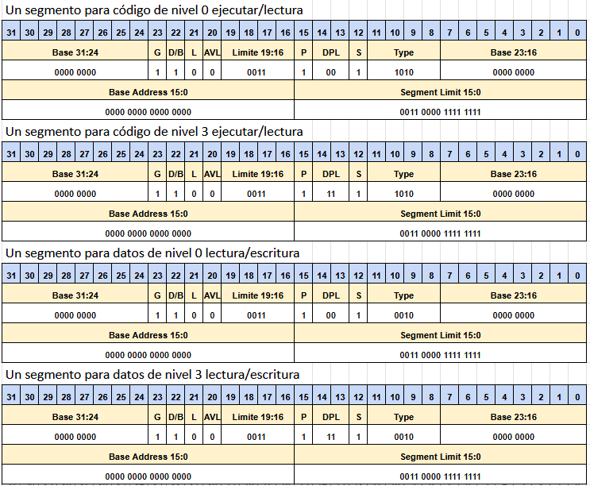

# System Programming: Pasaje a Modo Protegido
### Primera parte: Definiendo la GDT

Las preguntas que encuentren a lo largo de este trabajo son para guiarlos en el estudio y la resolución, alentamos a que se tomen en serio la tarea de responderlas ya que contienen conceptos clave necesarios para la comprensión del sistema en su conjunto. Tengan en cuenta que cualquiera de estas preguntas, y otras, pueden formar parte del quiz de entrega del TP.

1. Explorando el manual Intel *Volumen 3: System Programming. Sección 2.2 Modes of Operation*. ¿A qué nos referimos con modo real y con modo protegido en un procesador Intel? ¿Qué particularidades tiene cada modo?
Modo real labura por defecto en 16 bits, Podemos direccionar 1 MB de memoria, aunque los modos de direccionamiento son mas limitados que en modo protegido y no hay proteccion de memoria o niveles de privilegio.
Modo real tiene una forma en la que usamos 2 componentes distintas para llegar a un punto, osea direcciona la memoria con 2 componentes usa un selector de segmento y despues un offset.
El calculo es= Direccion Fisica = segmento * 16 + Offset
Ademas tiene interrupciones y todos los sets de instrucciones.


Modo protegido
En modo protegido hay 4 niveles distintos de proteccion y 4gb de memoria disponible. Ademas hay rutinas de atencion con privilegios y el set de instrucciones depende de el nivel de privilegio.

2. Comenten en su equipo, ¿Por qué debemos hacer el pasaje de modo real a modo protegido? ¿No podríamos simplemente tener un sistema operativo en modo real? ¿Qué desventajas tendría?
El modo real da muchas libertades al usuario, ademas de que por ejemplo podriamos direccionar y utilizar menor cantidad de memoria, el pasaje a modo protegido es importante para ademas poder configurar ciertas cosas del SO.

Anteriormente, detallamos que la memoria es un arreglo continuo de bytes y que podemos segmentarla de acuerdo a tamaño, nivel de protección y uso. Debemos indicar al procesador la descripción de los segmentos, es decir, cómo están conformados los segmentos. Los ejercicios a continuación tienen que ver con el armado de la tabla de segmentos.

3. Busquen el manual *volumen 3 de Intel en la sección 3.4.5 Segment Descriptors*. ¿Qué es la GDT? ¿Cómo es el formato de un descriptor de segmento, bit a bit? Expliquen brevemente para qué sirven los campos *Limit*, *Base*, *G*, *P*, *DPL*, *S*. También pueden referirse a los slides de la clase teórica, aunque recomendamos que se acostumbren a consultar el manual.
La GDT es la G
The global descriptor table o GDT, es un lugar de donde se selecciona la memoria, principalmente un selector de segmento que nos dice ciertas caracteristicas del cacho de memoria que estoy yendo a buscar,El mismo tiene un apartado de base,otro de segmento y luego distintos flags que nos dicen a que estoy apuntando.
Limit:Especifica el tamaño del segmento, si la granularidad es 0 el segmento puede ir de 1 byte a 1 MByte si granularidad es 1 el tamaño puede ir de 4KB a 4GB.
Base:Esto nos da la direccion lineal del segmento, nos dice donde esta ubicado, esta dividido en 3 partes distintas.
G:Esto es la granularidad, nos dice como esta segmentado el segmento valga la redundancia, si de a 1 byte o de a 4KB
P:Esto quiere decir si el segmento esta en memoria o no
DPL:Es el nivel de privilegio que tiene va de 0 a 3, osea tiene 4 niveles.
S:Esto especifica si es un segmento de sistema(0) o de codigo o datos(1)
    
4. La tabla de la sección 3.4.5.1 *Code- and Data-Segment Descriptor Types* del volumen 3 del manual del Intel nos permite completar el *Type*, los bits 11, 10, 9, 8. ¿Qué combinación de bits tendríamos que usar si queremos especificar un segmento para ejecución y lectura de código?
1010


Hay dos tipos de tablas que describen segmentos a nivel global y local (GDT y LDT). La tabla LDT no se utiliza en el modelo de segmentación *flat* que estaremos aplicando. Para este taller sólo vamos a usar la Tabla de Descriptores Global (GDT). En esta tabla se definen los descriptores de segmento que le dan estructura a la memoria en el nivel de segmentación.

5. Inicialmente, vamos a definir los siguientes segmentos en la GDT:

    a.  Un segmento para código de nivel 0 ejecución/lectura

    b.  Un segmento para código de nivel 3 ejecución/lectura

    c.  Un segmento para datos de nivel 0 lectura/escritura

    d.  Un segmento para datos de nivel 3 lectura/escritura

    
    Los 4 segmentos


Cada uno de estos segmentos deben direccionar los primeros 817 MiB[^1] de memoria y por estar usando segmentación *flat*, van a estar solapados. Escriban cómo quedarían los campos de cada descriptor de cada uno de los segmentos solicitados. Especifiquen el G, límite, la base, el tipo, P, DPL, S, P, AVL, L, D/B. Pueden completar con valores hexadecimales en la siguiente planilla: [*GDT Entradas*](https://docs.google.com/spreadsheets/d/1GczRjxYYt4jLSlZ5vJ7clHDZutnW1JJfl9pdL1wZI6w/edit?usp=sharing) (hacer una copia local para que no sea solo lectura).

Recuerden que el límite es el último valor accesible dentro del segmento (es inclusivo) y que el límite está relacionado con el nivel de granularidad **G** que hayan seleccionado.

> Noten que si bien definimos distintos niveles de privilegio, todos usan la misma región de memoria física, por lo cual, no hay una división real de permisos de accesos propuesto a nivel segmentación. Vamos a resolverlo en las próximas clases, cuando agreguemos paginación al kernel.
  
Ahora, trabajemos con el código provisto por la cátedra. Vamos a completar la tabla de segmentos y cargar los descriptores de segmento. Hemos provisto estructuras en C que permiten simplificar la especificación de los campos de cada descriptor.

6. En el archivo `gdt.h` observen las estructuras: `struct gdt_descriptor_t` y el `struct gdt_entry_t`. ¿Qué creen que contiene la variable `extern gdt_entry_t gdt;` y `extern gdt_descriptor_t GDT_DESC;`?
En el mismo archivo lo dice son Declaracion variables de la Tabla GDT, en el caso de gdt, son los descriptores de segmento, y el GDT_DESC es a donde se tiene que apuntar para que vay a la primer entrada


7. Buscar en el Volumen 3 del manual de Intel, sección 3.4.2 *Segment Selectors* el formato de los selectores de segmento. Observar en el archivo `defines.h` las constantes con los valores de distintos selectores de segmento posibles. Completen los defines faltantes en `defines.h` y entiendan la utilidad de las macros allí definidas. 
   **USAR LAS MACROS** para definir los campos de los entries de la gdt. En lo posible, no hardcodeen los números directamente en los campos.

```
#define GDT_CODE_0_SEL  ((GDT_IDX_CODE_0 << 3) | 0)  
#define GDT_DATA_0_SEL  ((GDT_IDX_DATA_0 << 3) | 0)  
#define GDT_CODE_3_SEL  ((GDT_IDX_CODE_3 << 3) | 0)  
#define GDT_DATA_3_SEL  ((GDT_IDX_DATA_3 << 3) | 0)  

#define DESC_CODE_DATA 1
#define DESC_SYSTEM    0
#define DESC_TYPE_EXECUTE_READ (((DESC_CODE_DATA<<2)|1)<<1)
#define DESC_TYPE_READ_WRITE   ((DESC_CODE_DATA<<2)>>1)


#define FLAT_SEGM_SIZE   (817 * 1024 * 1024)
```

8. En el archivo `gdt.c`, completen en el código la Tabla de Descriptores Globales (GDT) con los 4 segmentos definidos en el punto 5. (**usen los defines del punto anterior siempre que sea posible**)

```
    [GDT_IDX_CODE_0] =
        {
            .limit_15_0  = 0b0011000011111111, // 16 bits: 0x30FF
            .base_15_0   = 0b0000000000000000, // 16 bits: 0x0000
            .base_23_16  = 0b00000000,         //  8 bits: 0x00
            .type        = 0b1010,             //  4 bits: Código Execute/Read
            .s           = 0b1,                //  1 bit : Descriptor de código/datos
            .dpl         = 0b00,               //  2 bits: Nivel de privilegio 0
            .p           = 0b1,                //  1 bit : Presente en RAM
            .limit_19_16 = 0b0011,             //  4 bits: 0x3
            .avl         = 0b0,                //  1 bit : Disponible (no usado)
            .l           = 0b0,                //  1 bit : Modo 32 bits (no 64)
            .db          = 0b1,                //  1 bit : Tamaño por defecto de 32 bits
            .g           = 0b1,                //  1 bit : Granularidad de 4 KiB
            .base_31_24  = 0b00000000,
        },
    [GDT_IDX_CODE_3] =
        {
            .limit_15_0  = 0b0011000011111111, // 16 bits: 0x30FF
            .base_15_0   = 0b0000000000000000, // 16 bits: 0x0000
            .base_23_16  = 0b00000000,         //  8 bits: 0x00
            .type        = 0b1010,             //  4 bits: Código Execute/Read
            .s           = 0b1,                //  1 bit : Descriptor de código/datos
            .dpl         = 0b11,               //  2 bits: Nivel de privilegio 3
            .p           = 0b1,                //  1 bit : Presente en RAM
            .limit_19_16 = 0b0011,             //  4 bits: 0x3
            .avl         = 0b0,                //  1 bit : Disponible (no usado)
            .l           = 0b0,                //  1 bit : Modo 32 bits (no 64)
            .db          = 0b1,                //  1 bit : Tamaño por defecto de 32 bits
            .g           = 0b1,                //  1 bit : Granularidad de 4 KiB
            .base_31_24  = 0b00000000,
        },
    [GDT_IDX_DATA_0] =
        {
            .limit_15_0  = 0b0011000011111111, // 16 bits: 0x30FF
            .base_15_0   = 0b0000000000000000, // 16 bits: 0x0000
            .base_23_16  = 0b00000000,         //  8 bits: 0x00
            .type        = 0b0010,             //  4 bits: Código read/write
            .s           = 0b1,                //  1 bit : Descriptor de código/datos
            .dpl         = 0b00,               //  2 bits: Nivel de privilegio 0
            .p           = 0b1,                //  1 bit : Presente en RAM
            .limit_19_16 = 0b0011,             //  4 bits: 0x3
            .avl         = 0b0,                //  1 bit : Disponible (no usado)
            .l           = 0b0,                //  1 bit : Modo 32 bits (no 64)
            .db          = 0b1,                //  1 bit : Tamaño por defecto de 32 bits
            .g           = 0b1,                //  1 bit : Granularidad de 4 KiB
            .base_31_24  = 0b00000000,
        },
    [GDT_IDX_DATA_3] =
        {
            .limit_15_0  = 0b0011000011111111, // 16 bits: 0x30FF
            .base_15_0   = 0b0000000000000000, // 16 bits: 0x0000
            .base_23_16  = 0b00000000,         //  8 bits: 0x00
            .type        = 0b0010,             //  4 bits: CCódigo read/write
            .s           = 0b1,                //  1 bit : Descriptor de código/datos
            .dpl         = 0b11,               //  2 bits: Nivel de privilegio 3
            .p           = 0b1,                //  1 bit : Presente en RAM
            .limit_19_16 = 0b0011,             //  4 bits: 0x3
            .avl         = 0b0,                //  1 bit : Disponible (no usado)
            .l           = 0b0,                //  1 bit : Modo 32 bits (no 64)
            .db          = 0b1,                //  1 bit : Tamaño por defecto de 32 bits
            .g           = 0b1,                //  1 bit : Granularidad de 4 KiB
            .base_31_24  = 0b00000000,
        },
```

9. Ya está todo listo para cargar la GDT. Antes de eso, completen todo lo necesario en `kernel.asm` hasta "Habilitar A20" inclusive[^2]. Tengan en cuenta que las macros de impresión se encuentran definidas en `print.mac` y que para los colores hay constantes definidas en `colors.h`. Las macros reciben sus argumentos separados por comas, sin paréntesis ni nada. Por ejemplo:

    ```print_text_rm arg1, arg2, arg3, arg4, arg5.```

    *Hint*: investiguen para qué puede servir la instrucción **cli** en el manual 2.

```
print_text_rm  start_rm_msg,start_rm_len,0x0A,0,0
```


10. Busquen qué hace la instrucción LGDT en el Volumen 2 del manual de Intel. Expliquen con sus palabras para qué sirve esta instrucción. En el código, ¿qué estructura indica donde está almacenada la dirección desde la cual se carga la GDT y su tamaño? ¿dónde se inicializa en el código?
La estructura es la que hicimos en gdt.c si no tengo mal entendido, en la misma voy a tener los 4 descriptores de segmento, se iniciliza en GDT.C y lo traigo a kernel.asm


11. Completen el archivo `kernel.asm` en la sección de cargar la GDT usando lo averiguado en el punto 8 para cargar la GDT.

```
   lgdt [GDT_DESC]
```

12. Lean la guía de Qemu+gdb. Inserten un breakpoint luego de cargar la GDT. Podemos ahora comprobar el arranque de la máquina hasta ese punto. Para compilar y correr el kernel, pueden usar el target de make `qemu`. Para debuguear con GDB, pueden usar el target `gdb`.

### Segunda parte: Pasaje a modo protegido

Para pasar a modo protegido tenemos que completar los siguientes pasos:

- Deshabilitar interrupciones 

- Completar la GDT en memoria 

- Cargar la dirección de la GDT en el registro del procesador GDTR 

- Habilitar el modo protegido en el procesador 

- Hacer un jmp far al segmento de código de nivel 0 

- Cargar los selectores de segmento restantes

Recomendamos que también miren como referencia, el manual *volumen 3, sección 9.9.1 "Switching to Protected Mode"*. Tengan en cuenta, que algunos de los pasos que están ahí descritos, corresponden a paginación, que no estaremos activando aún. Los pasos que nos interesan ahora son: 1,2,3,4,5 y 9

Ya hemos hecho los primeros, deshabilitar interrupciones y completar la GDT. También ya cargamos el registro GDTR correctamente. Ahora deberíamos, habilitar el modo protegido, hacer el *jmp far* y cargar los registros selectores de segmento.

13. Investiguen en el manual de Intel *sección 2.5 Control Registers*, el registro CR0. ¿Deberíamos modificarlo para pasar a modo protegido? Si queremos modificar CR0, no podemos hacerlo directamente. Sólo mediante un MOV desde/hacia los registros de control (pueden leerlo en el manual en la sección citada).
Si tenemos que modificarlo pero no se puede directamente, usamos un registro y le ponemos un or 1 y recien ahi clavamos el 1 en el cr0


14. A continuación, completen la sección del `kernel.asm` escribiendo un código que modifique CR0 para pasar a modo protegido. Tengan en cuenta las averiguaciones y comentarios del punto 13.
```
mov eax, cr0
or eax, 1        ; Activa el bit PE
mov cr0, eax
```

15. Notemos que a continuación debe hacerse un jump far para posicionarse en el código de modo protegido. Miren el volumen 2 de Intel para ver los distintos tipos de JMPs disponibles y piensen cuál sería el formato adecuado. ¿Qué usarían como selector de segmento?
```
jmp CS_RING_0_SEL:modo_protegido
```

16. Dentro del modo protegido, vamos a cargar los registros selectores de segmento (`DS`, `ES`, `GS`, `FS` y `SS`). Todos se van a iniciar en el segmento de datos de nivel 0. Para esto, completar el archivo `kernel.asm` dentro del código que se ejecuta ya en modo protegido (etiqueta `modo_protegido`)

```
mov ax, DS_RING_0_SEL
    mov ds, ax
    mov es, ax
    mov fs, ax
    mov gs, ax
    mov ss, ax
```


17. Setear la pila del kernel en la dirección `0x25000`. Configuren los registros que indican dónde está la base y el tope de la pila.
```
    mov ebp, 0x25000
    mov esp, 0x25000
```
18. Impriman el mensaje de bienvenida a modo protegido e inserten breakpoint en la instrucción siguiente
```
print_text_pm start_pm_msg,start_pm_len,0x0A,0,0
```


## VAMOS A INICIAR EL KERNEL

Ya estamos listos para probar el arranque de la máquina. Para eso hay que compilar con `make` e iniciar `qemu`. Pueden hacer:

```
make gdb
```

para iniciar la sesión de qemu con el kernel y con gdb ya *attacheado.*

Otros targets del Makefile:

 - `make qemu`: se genera la imagen del kernel y se ejecuta qemu.

 - `make attach`: attachea gdb a una sesión de qemu existente.

 - `make gdb` hace estos dos últimos targets en secuencia

Ya dentro de gdb, no es necesario salir y volver a entrar, sino que podemos hacer (dentro de la terminal de gdb):

`kernel reload` 

Esto hará un rebuild del kernel y reiniciará la sesión de gdb (pero quedarán seteados todos los breakpoints que hayamos puesto en esta sesión).

19. Verifiquemos que la configuración haya quedado como esperamos:

- Con el comando `info registers` en `qemu` pueden:

- Ver `GDT= <BASE> <LIMITE>`. Verifiquen con `gdb` los valores de las entradas que cargaron.

- Ver los registros de control como el `CR0`

- Ver los registros de propósito general, `EFLAGS`, `EBP`, `ESP`, `RIP`, que también pueden ver con `gdb`.

- Ver los registros selectores de segmento.

20. Pueden ejecutar además `info gdt` dentro de gdb para verificar que la gdt se encuentra bien cargada.

## Tercera parte: Configurando la pantalla

Se va a acceder a la pantalla por un mapeo a memoria. La dirección física donde va a comenzar el buffer de la pantalla es `0x000B8000.`

La pantalla va a ser un arreglo de 50 filas x 80 columnas. En cada posición del arreglo va a haber 2 bytes que representan a una celda de la pantalla. Los colores y atributos se configuran acorde a una convención: [http://wiki.osdev.org/Text_UI](http://wiki.osdev.org/Text_UI)

21. Declaren un segmento adicional que describa el área de la pantalla en memoria que pueda ser utilizado sólo por el kernel. ¿Qué tamaño deberá tener considerando lo descrito en el párrafo anterior? Si el buffer de la pantalla comienza en `0x000B8000`[^3], piensen cuál debería ser la base y el límite. El tipo de este segmento debe ser de datos de lectura/escritura. Finalmente, definan el segmento en el archivo `gdt.c`.
El tamaño seria 50 * 80 * 2 ya que el buffer de video debe tener esas caracteristicas para que entre el tamaño de renderizado,la base seria la direccion que nos pasan osea 0x000B8000 y el limite seria el tamaño osea 50 * 80 * 2.

```
[GDT_IDX_VIDEO] =
    {
        .limit_15_0  = 0b0001111101000000, // 16 bits: 0x30FF
        .base_15_0   = 0b1000000000000000, // 16 bits: 0x0000
        .base_23_16  = 0b00001011,         //  8 bits: 0x00
        .type        = 0b0010,             //  4 bits: CCódigo read/write
        .s           = 0b1,                //  1 bit : Descriptor de código/datos
        .dpl         = 0b00,               //  2 bits: Nivel de privilegio 3
        .p           = 0b1,                //  1 bit : Presente en RAM
        .limit_19_16 = 0b0000,             //  4 bits: 0x3
        .avl         = 0b0,                //  1 bit : Disponible (no usado)
        .l           = 0b0,                //  1 bit : Modo 32 bits (no 64)
        .db          = 0b1,                //  1 bit : Tamaño por defecto de 32 bits
        .g           = 0b0,                //  1 bit : Granularidad de 4 KiB
        .base_31_24  = 0b00000000,
    }
```


22. Observen el método `screen_draw_box` en `screen.c` y la estructura `ca` en `screen.h` . ¿Qué creen que hace el método **screen_draw_box**? ¿Cómo hace para acceder a la pantalla? ¿Qué estructura usa para representar cada carácter de la pantalla y cuanto ocupa en memoria?
screen_draw_box hace un rectangulo en pantalla, accede a pantalla usando las columnas y filas, usa un struct por cada pixel que contiene el caracter y las caracteristicas del mismo.


23. Escriban una rutina `screen_draw_layout` que se encargue de limpiar la pantalla y escribir el nombre de los integrantes del grupo (o lo que deseen) en la misma en el archivo `screen.c` y llamen a dicho método desde `kernel.asm`. Pueden usar diferentes fondos, colores e incorporar dibujos si así lo quisieran.

En screen.c :
```
void screen_draw_layout(void) {

  screen_draw_box(0, 0, VIDEO_FILS, VIDEO_COLS, ' ', C_BG_LIGHT_GREY | C_FG_BLACK);

  print("Juan Manuel Nahas", (VIDEO_COLS - 17) / 2, 20, C_BG_LIGHT_GREY | C_FG_LIGHT_GREEN);
  
}
```

En kernel.asm :

```
extern screen_draw_layout
...
call screen_draw_layout
```


24. Resumen final, discutan con compañeros qué pasos tuvieron que hacer para activar el procesador en modo protegido. Repasen todo el código que estuvieron completando y traten de comprenderlo en detalle ¿Qué cosas les parecieron más interesantes? Seguro encontrarán partes que no comprenden del todo, no duden en consultar a los docentes.

Pasos para pasar a modo protegido:
Primero arrancamos en modo real y para eso hacemos:

1. Desahbilitar interrupciones:
```
 cli
```
2. Imprimimos el mensaje que estamos en modo real:
```
print_text_rm start_rm_msg,start_rm_len,0x0A,0,0
```

Ahora pasamos a modo protegido:
1.Habilitamos el A20
```
call A20_enable
```
2.Cargamos la GDT:
```
lgdt [GDT_DESC]
```
3.Seteamos el CR0 en 1:
```
    mov eax, cr0
    or eax, 1     
    mov cr0, eax
```
4.Saltamos a modo protegido:
```
jmp CS_RING_0_SEL:modo_protegido
```

Por ultimo una vez estamos en modo protegido:
1.Establecemos selectores de segmento:
```
    mov ax, DS_RING_0_SEL
    mov ds, ax
    mov es, ax
    mov fs, ax
    mov gs, ax
    mov ss, ax
```
2.Establecemos tope y base de la pila:
```
    mov ebp, 0x25000
    mov esp, 0x25000
```
3.Damos la bienvenida:
```
print_text_pm start_pm_msg,start_pm_len,0x0A,0,0
```

Y listo con eso estariamos.


# System Programming: Interrupciones

En la primera parte del TP, definimos la segmentación de la memoria, seteamos los valores iniciales de los registros de segmento, de los registros de la pila y mapeamos la pantalla a un segmento de video en memoria.
También, modificamos el bit menos significativo del registro CR0 para habilitar modo protegido e hicimos el pasaje entre modos.

En esta segunda parte, vamos a definir la tabla de interrupciones (IDT - Interrupt Descriptor Table) para que nuestro procesador pueda atender adecuadamente las interrupciones que provengan del software, dispositivos externos y excepciones internas.

En particular, vamos a implementar dos rutinas de atención de interrupción importantes: la correspondiente al reloj y la del teclado. Además, implementaremos dos _syscalls_ de nivel de usuario que utilizaremos en futuras actividades.

## Archivos provistos

A continuación les pasamos la lista de archivos que forman parte del
taller de hoy junto con su descripción:

- `Makefile`: encargado de compilar y generar la imagen del _floppy disk_.

- `pic.c`, `pic.h`: funciones `pic_enable`, `pic_disable`, `pic_finish` y `pic_reset`.

- `isr.h`, `isr.asm`: rutinas de atención de interrupciones.

- `idt.h`, `idt.c`: definición de la tabla de interrupciones.

- `keyboard_input.h`, `keyboard_input.c`: funciones para procesar los datos leídos del controlador de teclado.

Los ejercicios que vamos a realizar hoy les van a pedir interpretar
código de estos archivos y escribir código únicamente en los archivos
`isr.h`, `isr.asm`, `idt.h`, `idt.c`, `pic.c`, `defines.h` y `kernel.asm`(éstos dos últimos los utilizaremos del taller anterior junto con el
resto de los archivos provistos para la actividad de "_pasaje a modo
protegido_"\... **no olvidar las clausulas `#include` donde sea
necesario!**).

## Ejercicios

### Primera parte: Definiendo la IDT

En esta parte, vamos a definir y cargar la IDT en memoria. Utilizaremos los descriptores de excepciones, interrupciones y system calls. Además, vamos a trabajar en las rutinas de atención de interrupción (*ISR:Interrupt Service Routine*), en particular, las necesarias para atender las excepciones. Estas rutinas, en principio, sólo van a imprimir en pantalla la excepción generada, junto con el estado de los registros del microprocesador.

Completen en grupo los siguientes puntos:

1. En el archivo idt.h, pueden encontrar la IDT definida como un arreglo de `idt_entry_t` declarado sólo una vez como `idt`.
El descriptor de la IDT en el código se llama `IDT_DESC`.

En el archivo idt.c pueden encontrar la definición de cada una de las entradas y la definición de la función `idt_init` que inicializa la IDT definiendo cada una de sus entradas usando la macro `IDT_ENTRYx`.

a) Observen que la macro `IDT_ENTRY0` corresponde a cada entrada de la IDT de nivel 0 ¿A qué se refiere cada campo? ¿Qué valores toma el campo offset?
```
    .offset_31_16 = HIGH_16_BITS(&_isr##numero), Corresponde a la primera parte del offset
    .offset_15_0 = LOW_16_BITS(&_isr##numero),   Corresponde a la segunda parte del offset
    .segsel = GDT_CODE_0_SEL,                    Selector de segmento, si es de codigo, de data
    .type = 01110,                               Tipo de interrupcion si termina en 1 es trap sino es interrupt, en el medio tenes el D que ayuda a saber si es de 32 o 16 bits
    .dpl = 00,                                   El privilegio de nivel tambien existia en GDT es de 0 a 3
    .present = 1                                 Presente o no gordito
```

Pueden ayudarse de la siguiente figura.
Observen que los atributos son los bits 15 a 5 de la palabra de 32 bits superior.


> Figura 1: Entrada de la IDT - Interrupt Gate

b) Completar los campos de Selector de Segmento (`segsel`) y los atributos (`attr`) de manera que al usarse la macro defina una *Interrupt Gate* de nivel 0.
```
.segsel = GDT_CODE_0_SEL, porque es de nivel 0
.dpl = 0b00, porque es privilegio 0
.type = 0b01110, porque es ionterrupt gate de 32
```

c) De manera similar, completar la macro `IDT_ENTRY3` para que defina interrupciones que puedan ser disparadas por código no privilegiado (nivel 3).
```
.segsel = GDT_CODE_0_SEL, porque se sigue escribiendo en el mismo lugar
.dpl = 0b11, porque es privilegio 3
.type = 01110, porque es ionterrupt gate de 32
```

> **Nota:** Para el Selector de Segmento, recuerden que el código de las rutinas de atención de interrupción **corre a nivel de kernel**. ¿Cuál sería un selector de segmento apropiado acorde a los índices definidos en la `GDT[segsel]`? ¿Y el valor de los atributos si usamos _Gate Size_ de 32 bits?

2. Completar la función idt_init() con las entradas correspondientes a las interrupciones de reloj y teclado ¿Qué macro utilizarían?
```
  Interrupciones de reloj y teclado
  IDT_ENTRY0(32);
  IDT_ENTRY0(33);

```

3. Nos queda definir dos system calls. Estas son interrupciones de software que se van a poder usar con nivel de privilegio de usuario, en nuestro caso, nivel 3.
Usar la macro correspondiente para definir system calls con número 88 y 98.
```
  Syscalls
  IDT_ENTRY3(88);
  IDT_ENTRY3(98);
```

4. Completen `kernel.asm` inicializando la IDT y usen `lidt` para cargar la IDT en memoria

Compilen y ejecuten con qemu.
Pueden examinar la IDT con el comando `info idt` provisto por la cátedra para ver toda la tabla o usar GDB tradicionalmente para ver una entrada: `p idt[x]` dónde `x` es el índice de la entrada en la IDT.

```
inicializando la IDT
    call idt_init

cargar la IDT en memoria
    lidt [IDT_DESC]
```


### Segunda parte: Rutinas de Atención de Interrupción

El manejo de las interrupciones lo estaremos haciendo en esta parte del
taller.

1. En `pic.c` deberan completar la inicialización del PIC (los PICs), en particular, la función pic_reset() deberá enviarles las palabras de configuración.
Recordar remapear las interrupciones del **PIC1** a partir de la 32 (0x20) y del **PIC2** a partir de la 40 (0x28).

2. Agregar en `kernel.asm` la inicialización correspondiente para los PICs.
```
    call pic_reset   ; remapear PIC
    call pic_enable
```
3. Las rutinas de atención de interrupción son definidas en el archivo `isr.asm`.
Cada una está definida usando la etiqueta `_isr##` donde `##` es el número de la interrupción.
Busquen en el archivo la rutina de atención de interrupción del reloj.

Completar la rutina asociada al reloj, para que por cada interrupción llame a la función `next_clock`. La misma se encarga de mostrar, cada vez que se llame, la animación de un cursor rotando en la esquina inferior derecha de la pantalla.
La función `next_clock` está definida en `isr.asm`.

  ¿Qué oficiaría de prólogo y epílogo de estas rutinas? ¿Qué marca el `iret` y por qué no usamos `ret`?
El prologo seria pushad y el epilogo seria el popad y el iret
```
    pushad
    ; 1. Le decimos al PIC que vamos a atender la interrupción
    call pic_finish1
    ; 2. Imprimimos el reloj que gira en pantalla
    call next_clock
    .fin:
    popad
```

4. Completen la rutina de interrupción de teclado. La misma debe leer el scan code del puerto `0x60` y luego procesarlo con la función `process_scancode` provista en `keyboard_input.c`.
```
    call pic_finish1
    ; 2. Leemos la tecla desde el teclado y la procesamos con la funcion process_scancode (Durante Parte 2: Interrupciones) o tasks_input_process (Durante Parte 4: Tareas)
    in al, 0x60
    push eax
    call process_scancode
    add esp, 4
```


5. Escribir las rutinas asociadas a las interrupciones 88 y 98, para que modifique el valor de eax por 0x58 y 0x62 respectivamente.
Posteriormente, este comportamiento va a ser modificado para atender cada uno de los servicios del sistema.
```
_isr88:
  mov eax,0x58

_isr98:
  mov eax,0x62
```


6. Habiliten las interrupciones con `sti` en `kernel.asm`.
Luego, escriban un par de líneas que utilicen la instrucción `int` para probar alguna de las interrupciones de software que cargaron.
Pueden poner un breakpoint después de la interrupción para inspeccionar los registros y verificar que se produjo el cambio de valor en `eax`.

```
sti


    int 88
```

7. Compilen y ejecuten con qemu. Verifiquen la ejecución de la rutina de atención del reloj y de las interrupciones 88, 98.
Discutan con compañeros por qué va rotando el reloj.


# System Programming: Paginación.

En esta tercer parte vamos a inicializar y a habilitar los mecanismos de
manejo de memoria de nuestro kernel. En particular, activaremos el
módulo de paginación del microprocesador

## Organización de la memoria 

Primero vamos a explicar cómo se encuentra el mapa de memoria física
para comprender de qué modo inicializar las tablas de memoria. El primer
MB de memoria física será organizado según indica la figura
[1].
En la misma se observa que a partir de la dirección `0x1200` se
encuentra ubicado el *kernel*; inmediatamente después se ubica el código
de las tareas A y B. A continuación se encuentra el código de la tarea
Idle. El resto del mapa muestra el rango para la pila del kernel, desde
`0x24000` y a continuación la tabla y directorio de páginas donde
inicializar paginación para el kernel. La parte derecha de la figura
muestra la memoria a partir de la dirección `0xA0000`, donde se
encuentra mapeada la memoria de vídeo y el código del `BIOS`.


## Unidad de Manejo de Memoria

Ya viendo la memoria física en forma más general, vemos que se divide
en: *kernel*, *área libre kernel* y *área libre tareas*.

El área asociada al *kernel* corresponde al primer MB de memoria, el
*área libre kernel* a los siguientes 3 MB, y el *área libre tareas*
comienza en el cuarto MB de memoria.

La administración de las áreas libres de memoria (área libre de kernel y
área libre de tareas) se realizará a partir de una región de memoria
específica para cada una. Podemos comprenderlas como un arreglo
predefinido de páginas y dos contadores de páginas, uno para kernel y
otro para usuarix, que indican cuál será la próxima página a emplear de
cada región. Para páginas de kernel el arreglo va de `0x100000` a
`0x3FFFFF` y para páginas de usuarix de `0x400000` a `0x2FFFFFF`. Luego
de cada pedido incrementamos el contador correspondiente. En el
contexto de la materia no implementaremos un mecanismo que permita liberar
las páginas pedidas. Vamos a referirnos al módulo que implementa este
mecanismo como la **unidad de manejo de memoria**, o en inglés, *memory
management unit*, MMU.

Las páginas del *área libre kernel* serán utilizadas para datos del
kernel: directorios de páginas, tablas de páginas y pilas de nivel cero.
Las páginas del *área libre tareas* serán utilizadas para datos de las
tareas, stack de las mismas y memoria compartida bajo demanda.


La memoria virtual de cada una de las tareas tiene mapeado inicialmente
el *kernel* y el *área libre kernel* con *identity mapping* en nivel 0.
Además se mapearán las páginas de código correspondientes, la página de
memoria compartida y una página para la pila obtenida desde el *área
libre de tareas*.

A partir de la dirección virtual *0x07000000* se encontrará una página
de memoria compartida de lectura y escritura nivel 3. Esta página será
mappeada a pedido (on-demand) cuando se intente hacer una lectura o escritura en
este espacio. La página física debe encontrarse en la dirección
*0x03000000*.

El código de las tareas se encontrará a partir de la dirección virtual
*0x08000000* y será mapeado como sólo lectura de nivel 3 a la dirección
física del código correspondiente. Cada tarea puede utilizar hasta 8Kb
de código. El stack será mapeado en la página siguiente, con permisos de
lectura y escritura. La página física debe obtenerse del *área libre de
tareas*. Finalmente, luego de la pila se mapeará la página de memoria
compartida como sólo lectura de nivel 3. Esta página la usaremos más
adelante para que las tareas puedan acceder fácilmente a información
relevante del contexto de ejecución (teclas apretadas, tiempo desde el
arranque del sistema, etc).

### Notas 

- Por construcción del *kernel*, las direcciones de los mapas de memoria (`page directory` y `page table`) están mapeadas con *identity mapping*.

- En las funciones en donde se modifica el directorio o tabla de páginas, se debe llamar a la función `tlbflush` para que se invalide la *cache* de traducción de direcciones.

### Uso de qemu+gdb 

A continuación una descripción de los comandos que pueden utilizar en
gdb para acceder a la información sobre el mapeo de páginas:

-   `info page` - muestra información general sobre el mapeo

-   `info page [vaddr]` - muestra la traducción de *vaddr* dando el detalle de las entradas PD y PT correspondientes

-   `info page directory` - lista las entradas presentes del PD actual con sus atributos

-   `info table [idx]` - lista las entradas presentes de la i-ésima page table

-   `x /nuf [addr]` - Muestra el contenido de la dirección `[addr]`

-   `xp /nuf [addr]` - Muestra el contenido de la dirección física `[addr]`\
    `n` es el número que indica cuantos valores se mostrarán (default 1)\
    `u` es el tamaño de la unidad, puede ser[^1]:

      ------------------------ ----------------------------
      `b : byte`               `h : word (half-word)`
      `w : doubleword(word)`   `g : quadword(giant word)`
      ------------------------ ----------------------------

    `f` es el formato del número, puede ser:

      ------------- ------------------- -----------------
      `x : hex`     `d : decimal`       `u : sin signo`
      `o : octal`   `t : binario`       `c : char`
      `s : ascii`   `i : instrucción`   
      ------------- ------------------- -----------------

[^1]: Entre paréntesis el nombre consistente con gdb

## Ejercicios

### Primera parte: Preguntas teoricas 

a)  ¿Cuántos niveles de privilegio podemos definir en las estructuras de
    paginación?

b)  ¿Cómo se traduce una dirección lógica en una dirección física? ¿Cómo
    participan la dirección lógica, el registro de control `CR3`, el
    directorio y la tabla de páginas? Recomendación: describan el
    proceso en pseudocódigo

c)  ¿Cuál es el efecto de los siguientes atributos en las entradas de la
    tabla de página?

  - `D`
  - `A`
  - `PCD`
  - `PWT`
  - `U/S`
  - `R/W`
  - `P`


d)  ¿Qué sucede si los atributos U/S y R/W del directorio y de la tabla
    de páginas difieren? ¿Cuáles terminan siendo los atributos de una
    página determinada en ese caso? Hint: buscar la tabla *Combined
    Page-Directory and Page-Table Protection* del manual 3 de Intel

e)  Suponiendo que el código de la tarea ocupa dos páginas y
    utilizaremos una página para la pila de la tarea. ¿Cuántas páginas
    hace falta pedir a la unidad de manejo de memoria para el
    directorio, tablas de páginas y la memoria de una tarea?

f)  Completen las entradas referentes a MMU de `defines.h` y comprendan
    la función y motivación de dichos defines:

  - `VIRT_PAGE_DIR(X)`: Dada `X` una dirección virtual calcula el índice dentro del directorio de páginas de la PDE asociada.

  - `VIRT_PAGE_TABLE(X)`: Dada `X` una dirección virtual calcula el índice dentro de la tabla de páginas de la PTE asociada.

  - `VIRT_PAGE_OFFSET(X)`: Dada `X` una dirección devuelve el offset dentro de su página.

  - `CR3_TO_PAGE_DIR(X)`: Obtiene la dirección física del directorio donde `X` es el contenido del registro `CR3`.

  - `MMU_ENTRY_PADDR(X)`: Obtiene la dirección física correspondiente, donde `X` es el campo address de 20 bits en una entrada de la tabla de páginas o del page directory

g)  ¿Qué es el buffer auxiliar de traducción (*translation lookaside
    buffer* o **TLB**) y por qué es necesario purgarlo (`tlbflush`) al
    introducir modificaciones a nuestras estructuras de paginación
    (directorio, tabla de páginas)? ¿Qué atributos posee cada traducción
    en la TLB? Al desalojar una entrada determinada de la TLB ¿Se ve
    afectada la homóloga en la tabla original para algún caso?

### Segunda parte: Activando el mecanismo de paginación.

a)  Escriban el código de las funciones `mmu_next_free_kernel_page`,
    `mmu_next_free_user_page` y de `mmu_init_kernel_dir` de `mmu.c` para
    completar la inicialización del directorio y tablas de páginas para
    el *kernel*.

  > Recuerden que las entradas del directorio y la tabla deben realizar un mapeo por identidad (las direcciones lineales son iguales a las direcciones físicas) para el rango reservado para el kernel, de `0x00000000` a `0x003FFFFF`, como ilustra la figura [2]. Esta función debe inicializar también el directorio de páginas en la dirección `0x25000` y las tablas de páginas según muestra la figura [1] ¿Cuántas entradas del directorio de página hacen falta?

b)  Completar el código para activar paginación en `kernel.asm`.
    Recuerden que es necesario inicializar el registro `CR3` y activar
    el bit correspondiente de CR0. Esta inicialización debe realizarse
    antes de activar las interrupciones del procesador.

c)  Introduzcan un breakpoint luego de activar paginación y prueben
    hacer **info page** para comprobar que el mapeo identidad se realizó
    correctamente.

### Tercera parte: Definiendo la MMU.

a)  Completen el código de la función `mmu_map_page`, `mmu_unmap_page`

b)  Completen el código de `copy_page`, ¿por qué es necesario mapear y
    desmapear las páginas de destino y fuente? ¿Qué función cumplen
    `SRC_VIRT_PAGE` y `DST_VIRT_PAGE`? ¿Por qué es necesario obtener el
    CR3 con rcr3()?

c)  Realicen una prueba donde se compruebe el funcionamiento de
    `copy_page`. Pueden usar gdb con el comando `x` para inspeccionar el
    contenido de direcciones virtuales y `xp` para inspeccionar el
    contenido de direcciones físicas.

d)  Completen la rutina (`mmu_init_task_dir`) encargada de inicializar
    un directorio de páginas y tablas de páginas para una tarea,
    respetando la figura [2]. La rutina debe mapear las páginas de
    código como solo lectura, a partir de la dirección virtual
    `0x08000000`, el stack como lectura-escritura con base en
    `0x08003000` y la página de memoria compartida luego del stack.
    Recuerden que la memoria para la pila de la tarea debe obtenerse del
    area libre de tareas.

e)  Completen la rutina de atención de interrupción del Page Fault para
    que, si se intenta acceder al rango de memoria compartido on demand
    cuando este no está mapeado, se mapee. Respeten la figura
    [2]. Se debe mapear como de lectura-escritura a nivel usuario.

f)  A modo de prueba, en `kernel.asm` vamos a construir un mapa de
    memoria para una tarea ficticia (es decir, cargar el `CR3` de una
    tarea) e intercambiarlo con el del *kernel*. Para esto tendrán que
    usar la función antes construida, `mmu_init_task_dir`. Supongan que
    la tarea se encuentra ubicada en la dirección física 0x18000.

  - Una vez hecho el cambio de cr3, hagan dos escrituras en alguna
    parte de la zona de memoria compartida on-demand y luego vuelvan
    a la normalidad. Deberían ver el mensaje
    `”Atendiendo Page Fault...”` luego de la primer escritura y
    ningún mensaje luego de la segunda.

  - Inspeccionen el mapa de memoria con el comando `info page` con
    breakpoints una vez que se asigna el `CR3` de la tarea y cuando
    se restituye el `CR3` del kernel.
